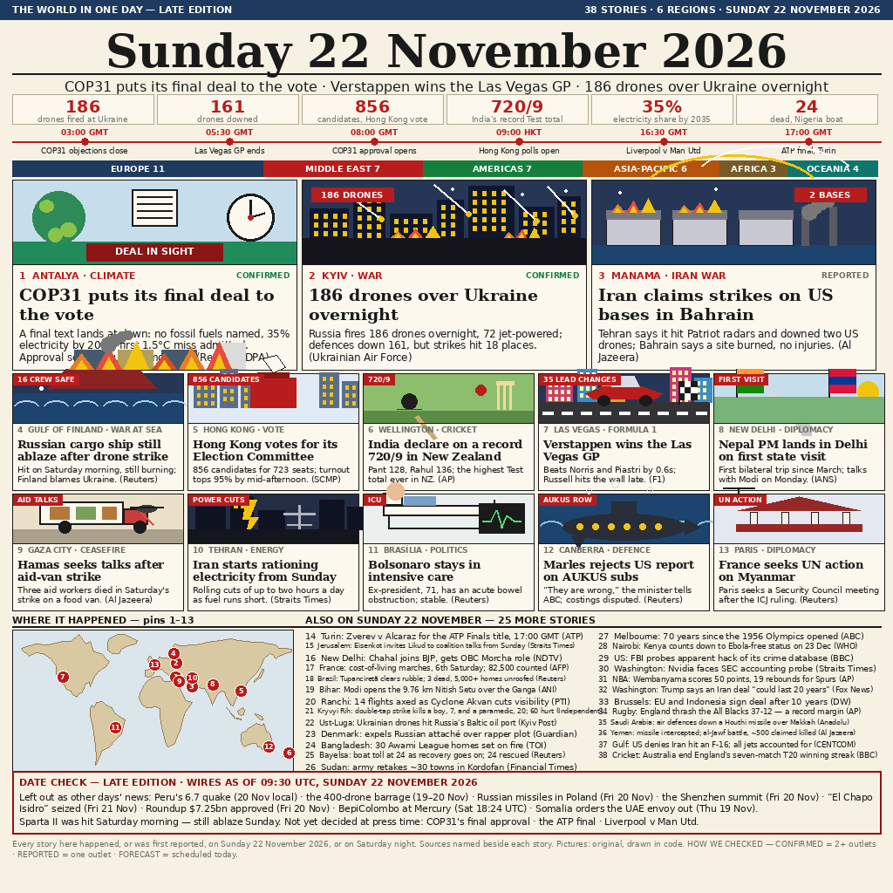

[](https://make.fun/bounty/news-image-20261122?utm_source=github&utm_medium=readme&utm_campaign=news-image-20261122)
[](https://make.fun/bounty/news-image-20261122/leaderboard?utm_source=github&utm_medium=readme&utm_campaign=news-image-20261122)
[](https://make.fun/bounty/news-image-20261122?utm_source=github&utm_medium=readme&utm_campaign=news-image-20261122)

# Sunday 22 November 2026 — one front page, 38 stories

A dense newspaper front page summing up Sunday 22 November 2026 in a
single 1024×1024 image: 3 leads, 10 features, 25 more stories, a stat
strip, a UTC timeline, a region bar, a world map with numbered pins and
a date check. Late edition — wires as of 09:30 UTC. Every story was
verified against live reporting before it was drawn — see `STORIES.md`
for the source of each one. Stories marked SAT happened on Saturday;
they are the overnight news Sunday woke to.

## The image



## Leads

1. **COP31 puts its final deal to the vote** — Antalya. A final text
   lands at dawn: no fossil fuels named, a 35% electricity share by
   2035, and the first admission the 1.5°C limit will be missed.
2. **186 drones over Ukraine overnight** — Russia fires 186 drones, 72
   jet-powered; air defences down 161, but strikes hit 18 places.
3. **Iran claims strikes on US bases in Bahrain** — Tehran says it hit
   Patriot radars and downed two US drones; Bahrain says a site burned,
   no injuries.

## How it is made

`draw.py` (Python + Pillow, stdlib only besides PIL) draws the whole page
from the story list in `STORIES.md` — masthead, stat strip, timeline,
region bar, world map, 13 original illustrations, ALSO list, date check
and footer. `main.ts` copies the finished `entry.png` to the output
directory.

```sh
python3 draw.py        # regenerates entry.png (1024x1024, < 1 MiB)
mkdir -p out && MAKEFUN_OUTPUT_DIR=out node main.ts   # grader-style run
```

## v2 — what changed from v1

v1 (judge 978,974, #444) was an early edition: no world map, no region
bar, no Ukraine overnight raid, and its ALSO list carried two Saturday
fixtures plus the Roundup settlement its own date check listed as left
out. v2 is a late edition: the 186-drone overnight raid and the Bahrain
strikes are leads, the Las Vegas GP result, the Hong Kong vote and
India's record 720/9 replace the fixtures, a world map with
numbered pins and a region bar (Europe 11, Middle East 7, Americas 7,
Asia-Pacific 6, Africa 3, Oceania 4) are added, and the date check now
names the 400-drone barrage (19–20 Nov) among the stories left out as
other days' news.
